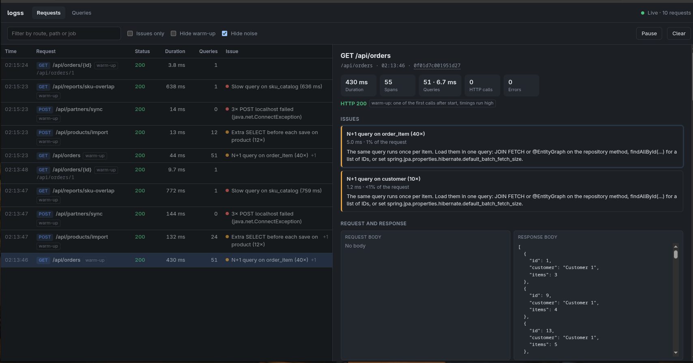

# logss

**See what your backend actually did, on your own machine.** logss receives OpenTelemetry traces from your
local app and shows each request with the SQL it ran (with real values), its request and response bodies,
and the problems in it: N+1 queries, slow queries, repeated failures, writes done one row at a time.

It runs locally as one jar, stores everything in a SQLite file, and needs no account or cloud service.

> Most of this code is AI-generated. See [How this was built](#how-this-was-built).



## What it finds

These are the results logss reports for the [demo app](demo/) in this repository:

| Request | What logss reports |
| --- | --- |
| `GET /api/orders` | **N+1 query on order_item (40×)** in `ShopController.listOrders`, with the JPA fix (`JOIN FETCH`, `@EntityGraph`, batch fetch size) |
| `POST /api/products/import` | **Extra SELECT before each save on product (12×)**: `save()` on an entity whose ID the app sets runs `merge()`, which loads the row first. Plus **Repeated INSERT (12×)**. |
| `POST /api/partners/sync` | **3× POST localhost failed (java.net.ConnectException)**, grouped into one issue |
| `GET /api/reports/sku-overlap` | **Slow query on sku_catalog (≈600 ms)**, with the SQL |
| `GET /api/orders/1` | No issues |

Issues are ranked by how much time they cost, not by how often they repeat. With the controller setting from
the [quick start](#quick-start), each issue also names the code that caused it, e.g.
`ShopController.importProducts → ProductRepository.save`. The UI follows your system's light or dark theme.

Compared with a general tracing UI such as Jaeger, logss is built for one developer debugging one app:

- **Problems first.** Ranked issues with a suggested fix instead of hundreds of raw spans.
- **Less noise.** OpenTelemetry internals, network details and host metadata are hidden behind a "raw" view.
- **SQL with values.** `where id=1152` instead of `where id=?`, and Hibernate spans merged with their SQL.
- **Loops folded.** A loop body reads as `ProductRepository.save ×12`, not 12 separate rows.
- **Bodies.** Request and response bodies on each request, with passwords and tokens masked.

## Quick start

You need Java 21 or newer.

**1. Build and start logss** (from this repository):

```bash
./mvnw package -DskipTests
java -jar target/logss.jar
```

It listens on http://localhost:4318: that address both receives traces and serves the UI.

**2. Start your app with the OpenTelemetry Java agent**, pointed at logss. Download
[`opentelemetry-javaagent.jar`](https://github.com/open-telemetry/opentelemetry-java-instrumentation/releases)
(tested with 2.32.0), then:

```bash
export OTEL_SERVICE_NAME=my-app
export OTEL_EXPORTER_OTLP_ENDPOINT=http://localhost:4318
export OTEL_EXPORTER_OTLP_PROTOCOL=http/protobuf
export OTEL_METRICS_EXPORTER=none
export OTEL_LOGS_EXPORTER=none
# Recommended: show the value bound to each ? in SQL
export OTEL_INSTRUMENTATION_JDBC_EXPERIMENTAL_CAPTURE_QUERY_PARAMETERS=true
# Recommended: a span per controller method, so issues name the method that caused them
export OTEL_INSTRUMENTATION_COMMON_EXPERIMENTAL_CONTROLLER_TELEMETRY_ENABLED=true

java -javaagent:/path/to/opentelemetry-javaagent.jar -jar your-app.jar
```

**3. Call your app**, then open http://localhost:4318. Requests appear a couple of seconds after they finish.

### Try it with the demo app

```bash
java -jar target/logss.jar          # terminal 1
demo/run-with-agent.sh              # terminal 2: downloads the agent, builds and starts the demo on :8080
demo/call-endpoints.sh              # terminal 3: calls each endpoint once
```

## Request and response bodies

The OpenTelemetry agent does not record bodies. For Spring Boot 3 apps, add the
[`logss-spring`](logss-spring/) library, which copies them onto the request's trace:

```bash
./mvnw -f logss-spring/pom.xml install    # not on Maven Central yet
```

```xml
<dependency>
    <groupId>com.logss</groupId>
    <artifactId>logss-spring</artifactId>
    <version>0.1.0-SNAPSHOT</version>
</dependency>
```

It does nothing until you start the app with `LOGSS_CAPTURE_ENABLED=true`. Bodies are cut off at 16 KB, and
values of fields such as `password`, `token`, `apiKey`-style keys and card numbers are replaced with `***`
(configurable with `logss.capture.masked-fields`). Add it to a development-only Maven profile if you do not want
it in production builds.

## Privacy and security

- logss listens on `127.0.0.1` only and has no login. Do not expose it to a network.
- Everything stays on your machine, in `logss.db` in the directory you start it from. That file contains SQL
  values and request bodies, so treat it like a database dump. Click **Clear** in the UI to delete it all.
- logss keeps the newest 1,000 requests.

## How it works

1. The agent sends spans to `POST /v1/traces` (OTLP over HTTP, protobuf).
2. logss stores them in SQLite. Spans of one request arrive in several batches, so a request is analyzed once its
   root span has arrived and two seconds have passed, or after 30 seconds without new spans.
3. Analysis groups identical SQL (literals replaced by `?`), detects issues, marks the first calls after a restart
   as warm-up, and records where in the code each issue came from.
4. The UI (plain HTML, CSS and JavaScript) polls a small JSON API every two seconds.

## Limits

- Tested with the OpenTelemetry Java agent 2.32.0, Spring Boot 3.2–3.5, Hibernate 6, PostgreSQL and H2. Other
  languages should work if they send OTLP over HTTP with protobuf, but are untested.
- One app at a time. Traces that cross several services are not shown as one request.
- OTLP over gRPC and JSON are not supported.

## Roadmap

- An MCP server, so coding agents can ask logss what a request did and check their own fixes.
- Before-and-after comparison by route.
- Issues across requests, e.g. the same query in every request.

## Development

```
logss/
├── src/main/java/…           the app: OTLP receiver, analysis, JSON API
├── src/main/resources/static the UI; styles/ is SCSS
├── logss-spring/             the optional body-capture library
└── demo/                     a Spring Boot app with deliberate problems
```

```bash
./mvnw verify                                   # app tests
./mvnw -f logss-spring/pom.xml verify           # library tests
```

The UI's stylesheet is compiled from SCSS. After changing anything in `src/main/resources/static/styles/`,
recompile and commit `main.css`:

```bash
sass src/main/resources/static/styles/main.scss src/main/resources/static/styles/main.css --no-source-map
```

## How this was built

Most of the code in this repository was written by an AI coding assistant, directed and tested by
the maintainer. For the most part, a human has reviewed it line by line. It has unit tests and was checked
against a real Spring Boot app and the demo app. If you find something wrong, please open an issue.

## License

[MIT](LICENSE)
